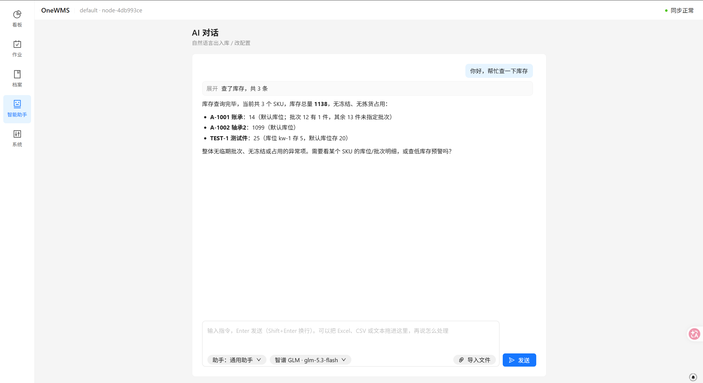

# OneWMS · AI-Driven Personalized Warehouse Management System

English | [中文](README.md)

> Download one app, tell the AI your warehousing needs in natural language, and it assembles fields, workflows and feature modules step by step — into a WMS that is truly yours.



## What is this

A **local-first** warehouse management system. It looks like a standard WMS app — Dashboard, Operations, Records, AI Assistant, System — but the core works completely differently:

- **Offline means complete software** — every node is a full system with data stored in local SQLite; no central server required;
- **Usable without AI** — complete form / barcode-scanning screens work out of the box; AI is an enhancement, not a dependency;
- **Manage the warehouse by chat** — say "check the inventory" in the AI Assistant and it returns SKU-level summaries (totals, batches, bin occupancy, restock hints); inbound, outbound and stocktaking are just as conversational;
- **Personalization is data, not code** — modules declare their fields, tools and workflow nodes via manifests; all customization is stored as data and can be exported as a migration package that moves freely between devices.

## Key Features

### 🗣️ Manage the Warehouse in Natural Language

Inbound, outbound, inventory queries and stocktaking — all via conversation:

> "Put those 3 boxes of A4 paper into bin B-05 in warehouse zone 2"

### 🤖 AI Is a Configuration Agent, Not a "Code Editor"

The AI never gets SQL access. All of its operations go through two channels:

| Channel | Purpose | Safeguards |
|---|---|---|
| **Slow channel (change config)** | Hide fields, enable modules, adjust workflows | AI generates a config patch → validation pipeline → **human confirmation** → hot-apply, no restart needed |
| **Fast channel (change data)** | Inbound/outbound, queries, stocktaking | Tool Calling through the tool bus; business rules (no negative stock, valid state transitions) are walls it cannot bypass |

### 📴 Local-First + Multi-Node Sync

Nodes sync through an event ledger (oplog) and stay consistent automatically within a LAN / VPN network:

- **LAN**: on the "Settings → Devices" page, share your LAN address with another device (or let it scan the QR code), then it just clicks "Add Node". The pairing is stored server-side and survives restarts;
- **Over the internet**: set up a VPN such as Tailscale / WireGuard and the same LAN protocol applies.

### 🖥️ One Frontend, Multiple Forms

A Tauri desktop app (~46 MB with an embedded Node.js runtime, zero environment setup) or browser access to the local service — data always lands in local SQLite.

## Feature Overview

| Module | Description |
|---|---|
| Inventory / SKU / Partners | Core warehousing capabilities |
| Outbound orders / Picking | State-machine-driven workflow engine |
| Stocktaking | Inventory verification |
| Shelf-life alerts | Example of modular extension |
| AI chat / agents / memory | Built-in, configurable AI workbench |
| Multi-node sync | oplog event ledger, direct LAN/VPN connectivity |

## Quick Start (Development)

Requires Node.js >= 22.

```powershell
# Install dependencies
npm install

# Build workspace packages (dev relies on dist/ artifacts; dev:server's predev hook also runs it automatically)
npm run build

# Start the backend server
npm run dev:server

# In another terminal, start the frontend
npm run dev:app
```

Configure AI: copy `.env.example` to `.env` and fill in the model info. Two provider types are supported:

```ini
# Cloud API (OpenAI-compatible, e.g. Zhipu)
ONE_AI_KIND=openai-compatible
ONE_AI_MODEL=glm-4
ONE_AI_BASE_URL=https://open.bigmodel.cn/api/paas/v4
ONE_AI_API_KEY=your-key

# Or local Ollama (no key needed)
ONE_AI_KIND=ollama
ONE_AI_MODEL=qwen3:8b
```

Without AI configured the system still runs normally — only the AI entry is disabled (`/api/chat` returns 503).

## Download & Use (No Dev Environment)

Download the Windows build from the [Releases](../../releases) page, either one:

- `OneWMS-<version>-setup-win-x64.exe`: double-click to install (recommended)
- `OneWMS-<version>-portable-win-x64.zip`: extract and double-click `OneWMS.exe`; no registry changes

Data lives in `data/` (SQLite + JSON), with automatic backups in `data/backups/` — one per day by default, keeping the latest 7, including AI config; the settings page lets you back up / restore manually at any time.

## Tech Stack

TypeScript as the single full-stack language + Tauri (Rust shell), in an npm workspaces monorepo:

| Package | Responsibility |
|---|---|
| `@one/core` ([packages/core](packages/core)) | Kernel: oplog event ledger, field registry, tool bus, Profile config pipeline, module system, sync & migration |
| `@one/wms` ([packages/wms](packages/wms)) | Warehousing business modules (as kernel plugins) |
| `@one/ai` + `@one/memory` ([packages/ai](packages/ai), [packages/memory](packages/memory)) | Vercel AI SDK, seamless switch between cloud API and local Ollama; conversation memory persistence |
| `@one/server` ([packages/server](packages/server)) | Node.js HTTP + WebSocket |
| `@one/app` ([packages/app](packages/app)) | React + JSON Schema dynamic forms |
| `packages/desktop` | Tauri desktop shell and packaging scripts |

Single-node internal structure:

```
┌─────────────── Single-node app (works offline) ───────────────┐
│  Natural-language chat          Forms / scanning (no AI needed)│
│      ↓                              ↓                          │
│  AI orchestration (intent → tool calls · needs → config DSL)   │
│      ↓                              ↓                          │
│  App kernel (module registry | workflow engine | tool bus)     │
│      ↓                                                         │
│  Pluggable domain modules (inventory core | batch | expiry |   │
│  picking | …)                                                  │
│      ↓                                                         │
│  SQLite (dynamic-field JSON columns + Oplog)                   │
│                          Config package Profile (exportable)   │
└────────────────────────────────────────────────────────────────┘
        ↓
  Sync engine (Oplog exchange + config version sync)
        ↓
  Multi-node network (direct LAN | VPN mesh)
```

## Package the Desktop App

Package locally (artifacts go to `dist/`):

```powershell
npm run package:desktop          # Full: installer + portable
npm run package:desktop:fast     # Portable only (skips NSIS, faster)
```

Artifacts:

- `dist/OneWMS-<version>-portable-win-x64.zip` — portable, ready to run after extraction
- `dist/OneWMS-<version>-setup-win-x64.exe` — NSIS installer
- `dist/latest.json` — auto-update manifest (generated when a signing key is available)

## Release a New Version

Set `version` to the same new value in the root [package.json](package.json), [packages/desktop/src-tauri/tauri.conf.json](packages/desktop/src-tauri/tauri.conf.json) and [packages/desktop/src-tauri/Cargo.toml](packages/desktop/src-tauri/Cargo.toml) (a missed spot is caught by the build script's version-consistency assertion), then commit and:

```powershell
git tag v0.2.0
git push --tags
```

GitHub Actions ([.github/workflows/release.yml](.github/workflows/release.yml)) automatically builds the installer + portable + `latest.json` + checksums and publishes them to the Releases page; pushes / PRs are also checked by [ci.yml](.github/workflows/ci.yml) with type checks and the full unit test suite.

## More Docs

- [DESIGN.md](docs/DESIGN.md): system design blueprint (architecture, config DSL, AI permission model, sync mechanism)
- [ARCHITECTURE.md](docs/ARCHITECTURE.md): kernel code architecture and dependency rules
